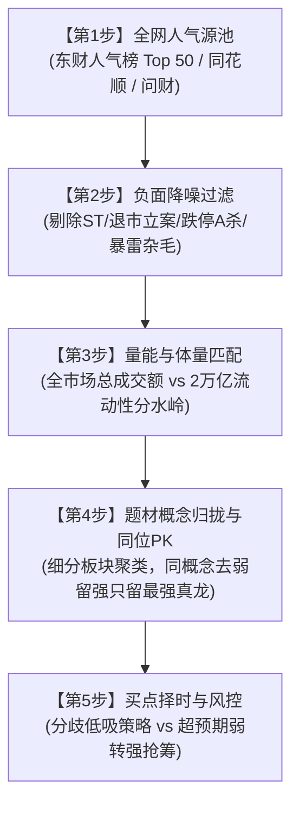

# 🐉 Dragon Stock Picker | A股人气龙头选股战法量化系统

[](https://www.python.org/)
[](LICENSE)
[](#)

> **“选龙头有很多可选条件，但有一点毋庸置疑的就是人气。好比你问世界上最高山，大家第一印象肯定是珠穆朗玛峰。龙头的人气肯定是很高，才会不断地攀升。”**
>
> 核心法则：**“选龙看人气，山高看珠峰，量能定体量，聚类留最强，买点看态势”**。

---

## 📖 战法简介

**Dragon Stock Picker** 是一套将 A 股顶级游资与短线高手的“人气龙头选股法”沉淀为结构化、全自动化分析工具的量化选股系统。

系统通过实时全网热度爬取、宏观量能分界（2万亿分水岭）、负面降噪剔除、题材板块归拢同位 PK 以及买点形态自动化识别，帮助交易者在每天盘前、盘中与盘后迅速锁定全市场最核心的真龙头，杜绝盲目追高与跟风杂毛。

---

## 🧭 五步层级递进筛选模型



---

## 🌟 核心策略要点

### 1. 宏观量能与体量匹配（2万亿分水岭）
- **两市成交额 > 2.0 万亿元（流动性泛滥/大牛市）**：资金充沛，溢出效应强，重点参与大盘中军、千亿蓝筹与趋势龙头。
- **两市成交额 < 2.0 万亿元（存量博弈/缩量震荡）**：流动性不足以推升大票持续上攻，**坚决剔除超大盘/权重中军**，全面聚焦于 **30 亿 ~ 250 亿元** 轻量级、高弹性的小盘中盘龙头。

### 2. 同题材同位去弱留强
- 退潮时跟风必先遭反噬杀跌，而唯有真龙头享有多头流动性溢价。
- 同概念板块内比拼：开盘封板时间、涨跌幅、换手率、股性辨识度。同题材只做第 1 身位，跟风助攻票坚决放弃。

### 3. 买点形态择时
| 交易模式 | 适用形态特征 | 最佳介入点 | 止损/风控红线 |
| :--- | :--- | :--- | :--- |
| **弱转强策略** | 前日烂板分歧/长上影线/大阴线洗盘，次日早盘集合竞价超预期大幅高开，或开盘迅速爆量翻红 | 集合竞价 9:25 抢筹确认，或开盘 5 分钟内爆量冲过前高瞬间 | 跌破当日开盘价或跌破昨日收盘价无支撑 |
| **分歧低吸策略** | 处于中短期上升均线（5日/10日线）多头排列，分时急跌缩量企稳，未破关键支撑位 | 5日均线附近、前一波涨停实体上方、分时底背离时低吸 | 跌破 5 日线或放量长阴破位立即执行纪律止损 |

---

## 📂 项目结构

```
dragon-stock-picker/
├── main.py                     # 主运行入口
├── requirements.txt            # Python 依赖清单
├── LICENSE                     # MIT 开源许可证
├── .gitignore                  # Git 忽略配置
├── SKILL.md                    # Antigravity / AI Agent 技能配置规范
├── docs/
│   └── methodology.md          # 完整战法理论与实战心法手册
├── scripts/
│   └── scan_dragon_stocks.py   # 全市场人气扫描分析引擎
├── data/                       # 扫描结果输出目录 (.gitkeep)
└── reports/                    # 报告输出目录 (.gitkeep)
```

---

## 🚀 快速上手

### 1. 环境准备
确保已安装 Python 3.8+，克隆本仓库并安装依赖：

```bash
git clone https://github.com/shuiseliuli/dragon-stock-picker.git
cd dragon-stock-picker
pip install -r requirements.txt
```

### 2. 执行选股扫描

```bash
python main.py
# 或
python scripts/scan_dragon_stocks.py
```

### 3. 输出演示

扫描器将打印宏观量能状态、过滤进度以及结构化分析表格，并在 `data/screened_dragons_latest.json` 中保存最新快照：

```text
================================================================================
🚀 启动 A股人气龙头五步战法自动化筛选器
================================================================================

【宏观量能定调】
• 沪深两市最新总成交额: 17,250.3 亿元 (沪市: 7,120.5 亿 / 深市: 10,129.8 亿)
• 2万亿分水岭判定: 🔻 存量缩量博弈 (<2万亿)
• 执行策略导向: 存量缩量博弈·剔除大盘子/聚焦中小盘高弹性
• 市值匹配过滤范围: [30.0 亿 ~ 250.0 亿] (严控大盘子权重，聚焦中小盘高弹性)

【步骤 1: 抓取东方财富实时人气榜前 50】...
成功获取 50 只人气标的。
成功获取 50 只标的实时行情切片。

【步骤 2 & 3: 执行负面降噪过滤与体量匹配】...
• 剔除标的数: 28 只 (其中大盘权重/微盘/ST/跌停票)
• 入围中小盘高弹性标的数: 22 只

【步骤 4 & 5: 题材归拢、同位PK与形态择时研判】...
=========================================================================================================
代码     名称     人气  现价   涨跌幅   市值(亿) 换手率   核心题材       形态定位       龙头身位
---------------------------------------------------------------------------------------------------------
002xxx   xxxx     #1    15.30   10.02%     85.2   18.5%   机器人概念     🔥 封板涨停·主升龙头  👑 题材真龙/身位领先
300xxx   xxxx     #3    22.40    7.85%    112.0   15.2%   低空经济       ⚡ 弱转强形态         👑 题材真龙/身位领先
...
=========================================================================================================
✅ 完整筛选结构化数据已写入: data/screened_dragons_latest.json
```

---

## 🤖 作为 AI Agent Skill 集成

本项目遵循智能体技能（Agent Skill）规范，已内置 `SKILL.md`。可以直接被接入到 Google Antigravity、Claude Code、Cursor、OpenClaw 等 AI 编码与交易助手环境中，作为专属“A股超短选龙助理”无缝调用。

---

## 🛡️ 纪律风控与铁律

1. **破位止损原则**：短线博弈以 5 日线或关键阳线起涨点为红线，若放量跌破且收盘无法收回，无条件认错止损。
2. **不买无承接的退潮龙头**：龙头一旦连板断裂且次日开盘跌停走 A 杀（无反抽承接），严禁盲目“抄底”，退潮期避险第一。
3. **仓位配比**：单票短线仓位控制在 20%~30%，严禁存量博弈行情下单票满仓。

---

## ⚠️ 免责声明

本仓库所有代码、数据与文档仅供量化交易策略研究与技术学术交流使用，不构成任何投资建议或买卖依据。股市有风险，入市需谨慎！投资者据此操作，风险自担。

---

## 📄 开源许可证

本项目基于 [MIT License](LICENSE) 开源。
