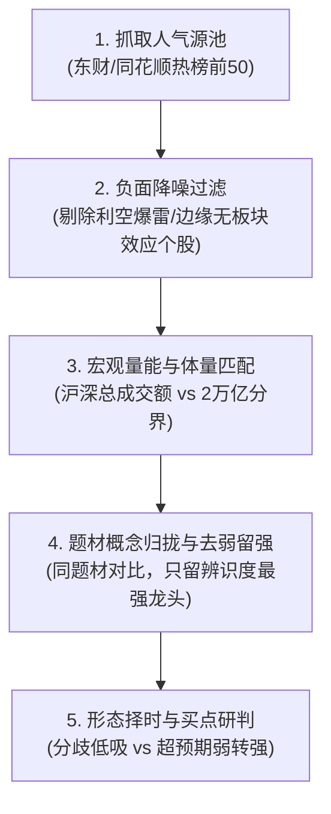

# A股人气龙头选股战法 (Dragon Stock Picker)

本技能将顶级游资与短线高手的人气选龙方法论沉淀为结构化、可落地的自动化分析工具流。核心法则为：**“选龙看人气，山高看珠峰，量能定体量，聚类留最强，买点看态势”**。

## 核心选股五步工作流



---

## 快速使用

### 1. 运行自动化全市场人气扫描器

在终端中执行：

```bash
python main.py
# 或
python scripts/scan_dragon_stocks.py
```

该脚本将自动执行：
- 抓取东方财富实时人气榜前 50 标的；
- 统计沪深两市最新实时成交额，自动切换“大盘中军模式（>2万亿）”或“中小盘弹性模式（<2万亿）”；
- 剔除暴雷、退市警示、跌停 A 杀及严重利空标的；
- 剔除与当前市场量能不匹配的超大盘/小盘失衡标的；
- 按题材分类归拢，比对各细分板块的涨停时间、涨跌幅与换手率，评选概念龙头；
- 识别形态信号并标记“分歧低吸”或“弱转强”关注梯队；
- 输出控制台分析表格与 JSON 报告。

### 2. 人工复核与买点研判指南

扫描脚本输出候选池后，结合 [methodology.md](./docs/methodology.md) 中的形态准则进行人工盘中/盘后确认：

| 交易模式 | 适用形态特征 | 最佳介入点 | 止损/风控红线 |
| :--- | :--- | :--- | :--- |
| **弱转强策略** | 前日烂板分歧/长上影线/大阴线洗盘，次日早盘集合竞价超预期大幅高开，或开盘迅速爆量翻红 | 集合竞价 9:25 抢筹确认，或开盘 5 分钟内爆量冲过前高瞬间 | 跌破当日开盘价或跌破昨日收盘价无支撑 |
| **分歧低吸策略** | 处于中短期上升均线（5日/10日线）多头排列，分时急跌缩量企稳，未破关键支撑位 | 5日均线附近、前一波涨停实体上方、分时底背离时低吸 | 跌破 5 日线或放量长阴破位立即执行纪律止损 |

---

## 详细文档参考
- 完整理论体系与实战心法详见：[A股人气选龙五步战法核心手册](./docs/methodology.md)
