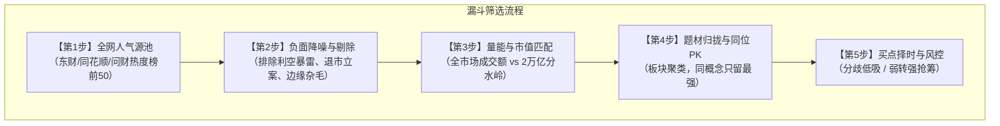

# A股人气龙头选股五步战法核心手册

## 概述与核心哲学

在 A 股短线与波段博弈中，资金情绪与市场合力是驱动股价超额爆发的核心动力。正如视频导师所述：
> “选龙头有很多可选条件，但有一点毋庸置疑的就是人气。好比你问世界上最高山，大家第一印象肯定是珠穆朗玛峰。龙头的人气肯定是很高，才会不断地攀升。”

一套完整的选股战法必须建立在**“客观数据筛选 + 宏观量能适配 + 题材强弱归拢 + 形态择时买点”**的闭环之上。

---

## 五步层级递进筛选模型

---

## 步骤详解

### 第一步：锁定顶级人气源池（Popularity Sourcing）
- **核心逻辑**：无极端人气不成真龙，资金汇聚之处才有超额流动性溢价。
- **监控标的池**：
  - 东方财富个股人气榜（Top 50）
  - 问财热度榜 / 同花顺个股热榜
- **核心价值**：反映当下全市场数以千万计短线资金、量化基金、活跃游资最密集关注的眼球与筹码焦点。

---

### 第二步：负面降噪与虚假热度剔除（Negative Filtering）
人气分为“合力看多的人气”与“口诛笔伐的黑红人气”。上榜股票必须剔除以下两类：
1. **利空爆雷型人气（黑红坚决不碰）**：
   - 证监会立案调查、财务造假、被实施退市风险警示（*ST/ST）。
   - 控股股东大比例爆仓、巨额违规占用资金、大额利空减持。
   - 业绩断崖式巨亏、重大利空复牌连续一字跌停导致的恐慌关注。
2. **边缘非主流杂毛（无板块效应）**：
   - 因单一不可复制的微小偶发消息异动，但其所属板块无任何其他联动个股（孤儿票）。
   - 主力自导自演的庄股、流动性陷阱股。

---

### 第三步：全市场量能与体量匹配（Market Regime & Liquidity Alignment）
视频明确指出的核心资金分水岭：**2 万亿元**。
不同量能环境下，市场推升不同体量股票的流动性能力截然不同：

| 市场量能状态 | 两市总成交额 | 市场风格偏好 | 选股策略策略导向 |
| :--- | :--- | :--- | :--- |
| **流动性泛滥/大牛市** | **> 2.0 万亿元** | 资金溢出效应强，增量充沛，可推动大盘中军、千亿白马持续走多头趋势 | **顺势做大盘趋势中军**，容纳大资金 |
| **存量博弈/缩量震荡** | **< 2.0 万亿元**（如当前 ~1.5万亿） | 存量互掏口袋，流动性不足以承接大盘蓝筹持续推升，大票冲高必回落 | **果断剔除超大盘/千亿权重股**；将火力全面聚焦于 **30 亿 ~ 250 亿元** 轻量级、高弹性的小盘中盘龙头 |

---

### 第四步：题材概念归拢与同位去弱留强（Clustering & Dragon PK）
经过前三道工序后，将剩余标的按当前核心概念进行归拢聚类，并在同题材内执行残酷的淘汰赛：
1. **概念归拢**：把同一主线题材（如半导体封装、智能装备、算力配套、绿色节能等）的标的归入同一池。
2. **龙头 PK 规则**：
   - **涨停强度**：优先保留开盘封板最早、封单占成交比最高、涨幅最凌厉的个股。
   - **辨识度与身位**：梯队连板高度更高、板块启动时率先发号施令的“排头兵”为真龙。
   - **去弱留强**：若同概念内有两只或多只标的，**只保留最强的那只，跟风助攻票坚决剔除**。因为退潮时跟风必先遭反噬杀跌，而唯有龙头享有多头流动性溢价。

---

### 第五步：形态分析与买点执行决策（Entry Setups & Risk Control）
选定最终标的后，绝非盲目追高，而是等待确定性的右侧形态信号触发：

#### 买点一：分歧低吸（Low-Suck Strategy）
- **适用场景**：主线龙头在主升浪中经历盘中急跌或良性分歧。
- **形态特征**：
  1. 日 K 线处于中短期均线（5日/10日均线）上方，均线多头排列。
  2. 盘中急跌但呈现明显缩量，未触及核心防守位。
  3. 分时图跌至均价线或早盘低点附近出现止跌承接大单。
- **介入时点**：靠近 5 日均线附近或分时底背离时分批潜伏，博弈午后回封或次日阳包阴。

#### 买点二：弱转强参与（Weak-to-Strong Strategy）
- **适用场景**：前一日分歧洗盘后，次日资金超预期反包。
- **形态特征**：
  1. 前一日出现烂板炸板、冲高回落长上影线或大阴分歧。
  2. 次日早盘 9:15 ~ 9:25 集合竞价，不仅未被核按钮，反而超预期大幅高开（如高开 3%~5% 以上）。
  3. 9:25 集合竞价成交量显著放大（爆量竞价），开盘后 3~5 分钟内快速拉升翻红并突破昨日分歧高点。
- **介入时点**：9:25 竞价确认超预期挂单介入，或开盘回踩不破开盘价并拐头向上时追击。

---

## 铁律风控与仓位管理

1. **破位止损原则**：短线博弈以 5 日线或关键阳线起涨点为红线，若放量跌破且收盘无法收回，无条件认错止损。
2. **不买无承接的退潮龙头**：龙头一旦连板断裂且次日开盘跌停走 A 杀（无反抽承接），严禁盲目“抄底”，退潮期避险第一。
3. **仓位配比**：单票短线仓位控制在 20%~30%，严禁存量博弈行情下单票满仓。
